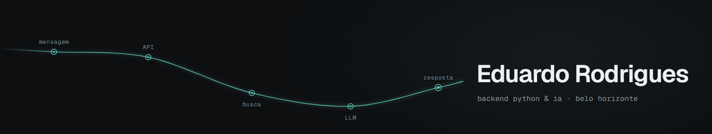
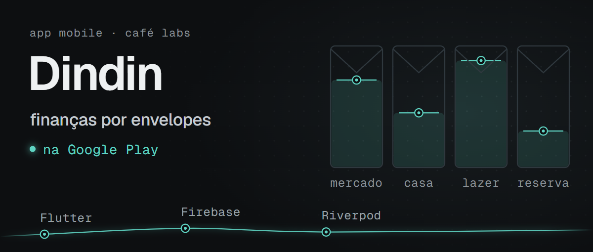
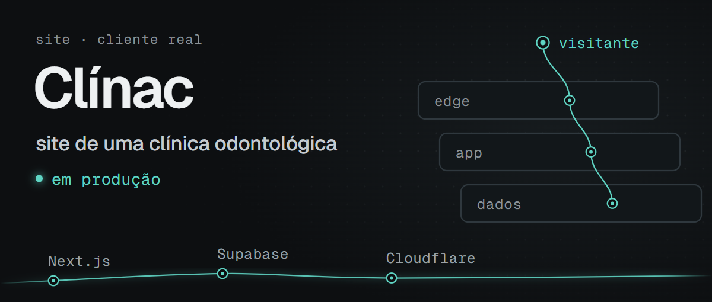
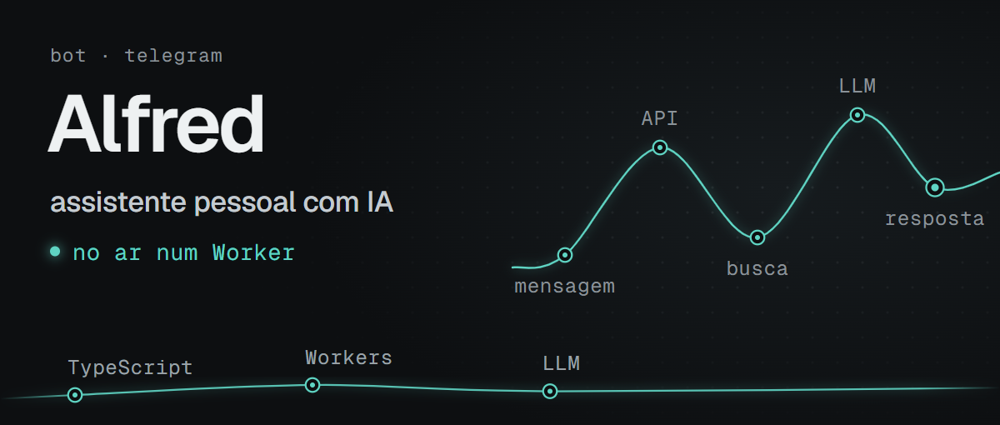
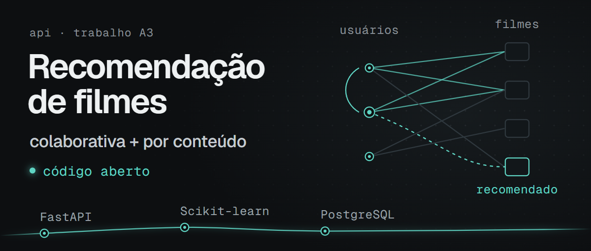
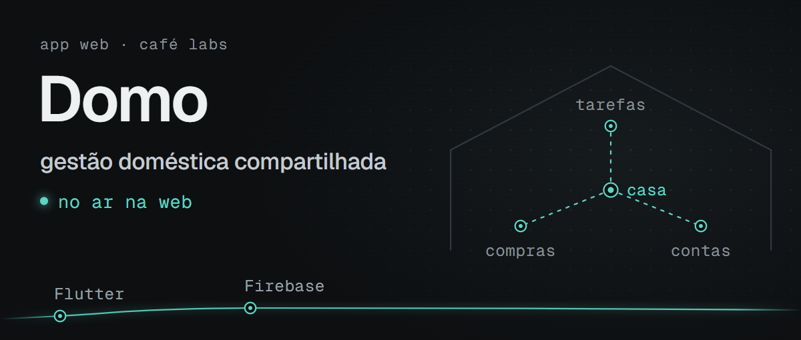
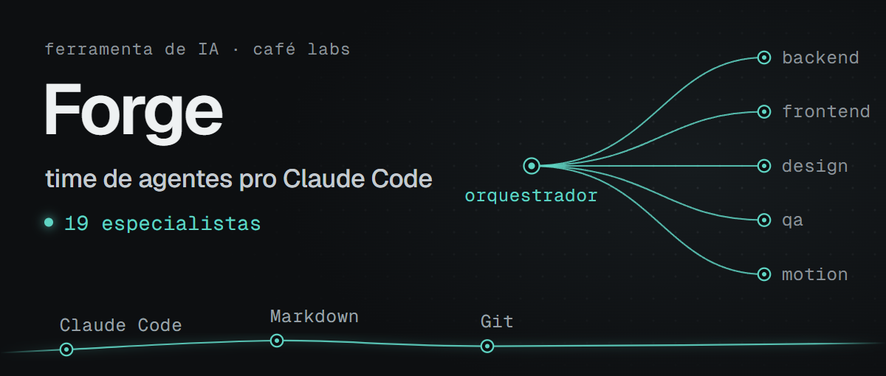

  

  
<b>Dev backend Python & IA</b> · Sistemas de Informação (UniBH, conclusão dez/2026) · Belo Horizonte

  
  
  

---

Entrego software que roda de verdade: um app na Google Play, o site de uma clínica real e um assistente no Telegram que responde com base nas minhas anotações. Sou co-fundador da [Café Labs](https://cafelabs.net), onde a gente constrói produto e atende cliente.

**Procurando:** estágio ou júnior em backend Python, IA ou full-stack. BH (presencial/híbrido) ou remoto.

## Projetos

  
  

- **Dindin** ([Play](https://play.google.com/store/apps/details?id=com.cafelabs.dindin) · [código](https://github.com/CafeLabsCorp/dindin) · [web](https://dindin.cafelabs.net)) — Flutter + Firebase. Versão 1.1.2 aprovada na Play em 11/11/2026; Termos de Uso e Privacidade aprovados por advogado.
- **Clínac** ([código](https://github.com/EduOlivi/clinac-odontologia) · [site](https://clinac-odontologia.clinacodontologia.workers.dev)) — HTML estático migrado para Next.js 16 em Cloudflare Workers. Supabase com Row Level Security testada contra o banco real (9/9 blocos), Turnstile, painel de leads e backup semanal.

  
  

- **Alfred** (repo privado) — TypeScript num Cloudflare Worker. Pra caber em 10 ms de CPU por requisição, o índice de busca é montado no GitHub Actions e embutido no deploy; a agenda nunca passa pelo LLM, pra ele não inventar horário.
- **Recomendação de filmes** ([código](https://github.com/EduOlivi/A3-montanha)) — FastAPI + Scikit-learn: similaridade entre usuários e TF-IDF com cosseno, matrizes pré-calculadas na inicialização, PostgreSQL via SQLAlchemy.

  
  

- **Domo** ([web](https://domo.cafelabs.net)) — Flutter + Firebase. Despensa, lista de compras e tarefas por membro da casa; no ar na web, em preparação para a Google Play.
- **Forge** ([código](https://github.com/CafeLabsCorp/forge)) — orquestrador + 19 subagentes (produto e estúdio criativo) para montar MVPs com o Claude Code. Par do [Mind](https://github.com/CafeLabsCorp/mind-template), a base de notas em Markdown que o Alfred consulta.

## Stack

**Backend** Python, FastAPI, SQLAlchemy, PostgreSQL, Supabase, Firebase 
**IA & dados** LLMs, RAG e busca híbrida, Scikit-learn, Pandas 
**Front & mobile** TypeScript, Next.js, React, Flutter 
**Infra** Git, GitHub Actions, Cloudflare Workers

## Experiência

- **Café Labs** — Co-fundador e desenvolvedor · atual
- **Clínac Odontologia** — Desenvolvedor web · site em produção e painel de leads
- **Notificações PBH** — Auxiliar administrativo · jan/2024 – jan/2026

Certificado: Introdução à Ciência de Dados (Cisco Networking Academy, 2026).
